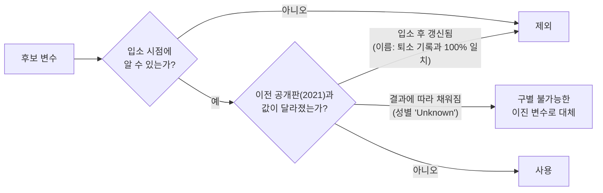
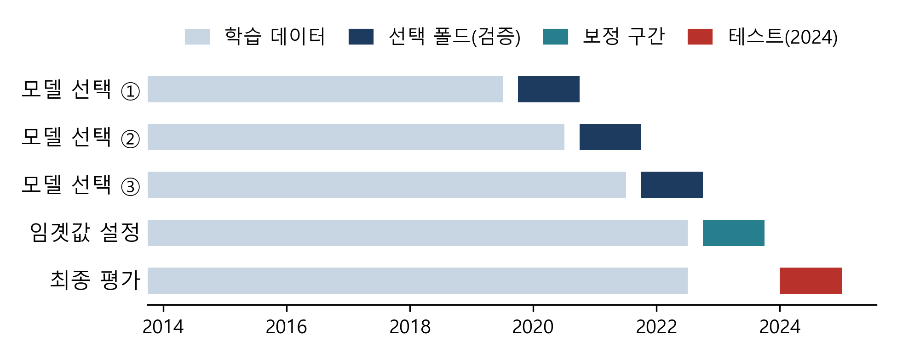
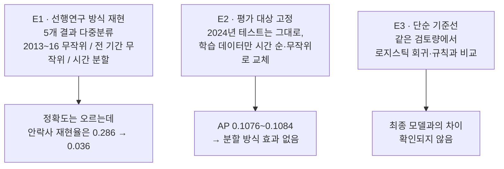
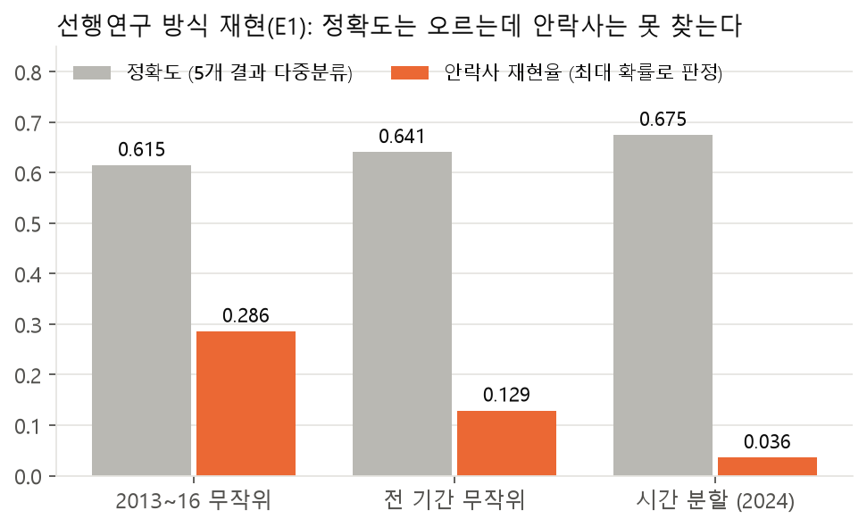
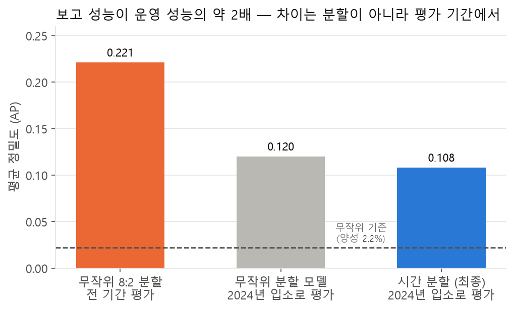
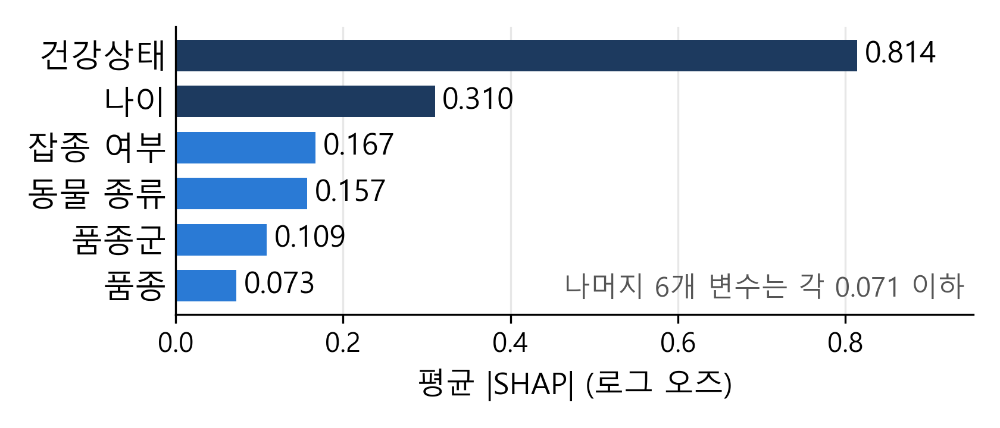
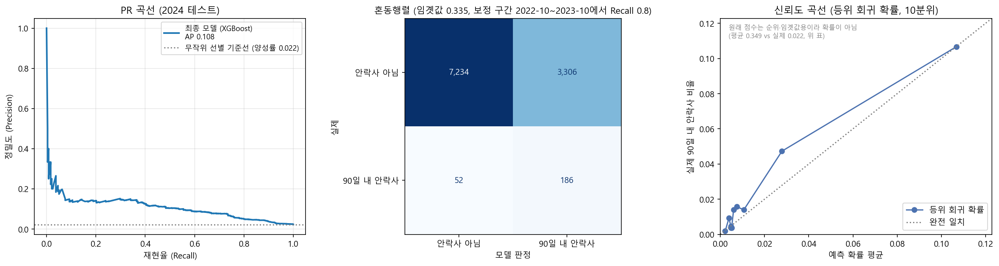

# 동물보호소 안락사 예측에서 평가 설계가 보고 성능에 미치는 영향

> **2026 한국정보기술학회 추계 종합학술대회 투고 · 단독 저자 (전건우) · 2026.09–10**
>
> *Effects of Evaluation Design on Reported Performance in Predicting Euthanasia of Shelter Dogs and Cats*
>
> 같은 데이터·같은 모델이라도 **어떻게 평가하느냐에 따라 보고되는 성능이 2배까지 달라진다.**
> 오스틴 동물보호센터 공개 데이터로 그 원인을 누수·판정 방식·평가 기간으로 나누어 검증했습니다.

**출발점:** 교내 학회 팀 프로젝트([animal-shelter-matrix](https://github.com/j2tori-design/animal-shelter-matrix))에서 쓴 무작위 분할과 정확도 중심 평가에 의문을 갖고, 문제를 처음부터 다시 정의했습니다.

## 한눈에 보기

| 발견 | 수치 |
|---|---|
| 정확도가 높아도 안락사는 거의 못 찾는다 | 정확도 0.675인데 안락사 재현율 **0.036** (최대 확률로 판정할 때) |
| 그런데 같은 모델로 위험 순으로 검토하면 | 같은 3,492건 검토로 안락사 **82.6%** 탐지 → 원인은 모델이 아니라 **판정 방식** |
| 무작위 평가는 운영 성능을 부풀린다 | 무작위 8:2 전 기간 평가 AP 0.221 vs 2024년 평가 0.108 → **약 2배** |
| 그 차이는 분할 방식이 아니라 **평가 기간**에서 | 2024년을 고정하고 학습 데이터만 바꾸면 AP 0.1076~0.1084로 같음 |
| 결과 확정 후 채워지는 기록(누수) 발견 | 성별 'Unknown' — 이전 공개판(2021) 대조로 확인 |
| 최종 모델 | 입소의 **32.4%** 만 검토해 안락사의 **78.2%** 탐지 (AP 0.108, 무작위의 4.9배) |
| 정직한 한계 | '아픈 동물부터, 그다음 나이 많은 순' 단순 규칙보다 낫다고 **확인되지 않음** |

---

## 1. 연구 질문

> 공개 행정 데이터로 보호소 결과를 예측할 때, 무엇이 **보고 성능**(논문에 보고되는 성능)을 **운영 성능**(실제 미래 입소에서의 성능)과 다르게 만드는가?

선행 연구는 대부분 여러 시기의 데이터를 구분 없이 무작위로 나누고 정확도로 평가했습니다. 하지만 안락사는 개·고양이 결과의 약 3%뿐이라 정확도로는 탐지력을 알 수 없고, 보호소 기록에는 결과에 따라 나중에 채워지는 항목이 섞일 수 있습니다.

| 기여 | 내용 |
|---|---|
| ① 누수 탐지 절차 | 공개 데이터의 **이전 판과 대조**해 결과에 따라 나중에 채워지는 기록을 찾는다 |
| ② 시점 기준 분할 | 라벨이 **확정되는 시점**을 기준으로 학습·선택·보정·테스트 구간을 나눈다 |
| ③ 실험 설계 | 보고 성능과 운영 성능의 차이를 **평가 기간·지표·분할 방식**으로 나누어 본다 |

## 2. 데이터와 누수 점검

- City of Austin 공개 데이터: 입소 173,812건, 퇴소 173,775건 (2013-10 ~ 2025-05)
- 라벨: 개·고양이의 **입소 후 90일 이내 안락사** (안락사의 97.5%가 90일 이내). 보호자 요청 안락사는 입소 때 결과가 정해지므로 제외
- 특성: 입소 시점에 알 수 있는 12개 (동물 종류, 입소 유형, 건강상태, 품종군, 생애단계, 품종·색상, 나이, 입소 월, 혼종·다색·중성화 여부)



**성별 'Unknown'이 누수인 세 가지 근거**

1. 2021년 공개판 작성 당시 보호소에 있던 입소의 Unknown은 7건 모두 이후 성별로 채워졌지만, 이미 퇴소한 입소는 4,261건 중 2건만 바뀌었다
2. 입소 기록의 Unknown 비율: 24시간 이내 안락사 17.3% → 24시간~90일 5.4% → 90일 초과 0.0%
3. 성별 변수의 성능 향상(AP +0.0187)은 Unknown 입소에서만 나타났다 (Unknown이 아닌 입소만 보면 +0.0012로 사라짐)

## 3. 결과가 확정되는 시점 기준 분할

<p align="center"></p>

- 입소 연도로만 나누면 2023년 검증 입소의 7.19%가 모델 선택 시점 **이후에** 결과가 확정된다 → 각 구간의 학습 데이터는 `입소일 + 90일 ≤ 구간 시작`인 입소로 한정
- **선택 폴드**(2019-10~2022-10, 12개월 × 3)에서는 모델만 고르고, **보정 구간**(2022-10~2023-10)에서는 검토 기준(재현율 0.8 목표 임곗값)만 정하고, **2024년 테스트**는 어떤 선택에도 쓰지 않는다
- 주지표: 평균 정밀도(AP), 보조: Lift(AP ÷ 양성 비율)·ROC-AUC. 신뢰구간은 같은 동물의 입소를 묶은 군집 부트스트랩 500회

## 4. 비교 실험



### E1 — 판정 방식이 탐지율을 바꾼다

<p align="center"></p>

정확도는 선행연구(0.63~0.65)와 비슷하고 시간 분할에서 오히려 가장 높았지만(평가 데이터의 안락사 비율이 낮아져 다수 결과를 맞히기 쉬워짐), 최대 확률로 판정하면 안락사는 거의 찾지 못한다. 같은 다중분류 모델도 **안락사 확률 순으로 3,492건을 검토하면 82.6%** 를 찾는다.

### E2 — 무작위 평가의 높은 수치는 평가 기간에서 온다

<p align="center"></p>

| 학습 데이터 (평가는 모두 2024년 입소) | AP [95% CI] | 차이 |
|---|---|---|
| T1 과거 (~2022-07) | 0.1077 [0.087, 0.143] | 기준 |
| T2 과거 (~2023-10) | 0.1084 [0.087, 0.145] | +0.0008 [−0.004, 0.005] |
| R1 무작위 (T1 크기) | 0.1076 [0.087, 0.143] | −0.0009 [−0.004, 0.001] |
| R2 무작위 (전체) | 0.1076 [0.087, 0.143] | −0.0009 [−0.004, 0.002] |

→ 평가 대상을 고정하면 분할 방식은 성능을 바꾸지 않는다. 무작위 평가의 2배 AP는 평가 기간·대상의 양성 비율 차이(2.7% vs 2.2%)에서 온다. 조건에 따라 일반 교차검증도 타당할 수 있다는 Bergmeir 등(2018)의 관점과 일치한다.

### E3 — 단순 기준선과 비교

| 방법 (2024년 테스트) | AP [95% CI] | Lift | ROC-AUC | 재현율* |
|---|---|---|---|---|
| **최종 (XGBoost)** | **0.108** [0.087, 0.143] | 4.88 | 0.811 | **0.782** |
| 로지스틱 회귀 | 0.102 [0.082, 0.135] | 4.63 | 0.803 | 0.777 |
| 규칙 (건강상태 → 나이 순) | 0.091 [0.071, 0.121] | 4.11 | 0.773 | 0.756 |
| 무작위 선택 | 0.024 [0.020, 0.034] | 1.09 | 0.508 | 0.332 |

\* 같은 3,492건(입소의 32.4%) 검토 시

<p align="center"></p>

변수 단위 SHAP도 건강상태(0.814)·나이(0.310)가 1·2위 → 입소 시점 예측력의 대부분은 **건강상태와 나이**에서 나오며, 복잡한 모델의 추가 이득은 확인되지 않았다.

<p align="center"></p>

## 5. 결론과 권고

1. 운영과 같은 **미래 기간**으로 평가한다
2. 정확도 대신 **검토량별 재현율**을 보고한다
3. 공개 데이터는 **이전 판과 대조**해 결과 반영 기록을 점검한다
4. **단순 규칙**을 기준선으로 함께 보고한다

**한계:** 테스트 결과를 예비 분석에서 본 적이 있고, Unknown 근거(7건)가 적으며, 단일 보호소 데이터다. 목적이 모델 개선이 아니라 평가 절차 검증이므로 모델은 기존 기법 비교에 그쳤고, 예측이 곧 개입 효과는 아니다.

---

## 저장소 구성

| 경로 | 내용 |
|---|---|
| `최종자료/Animal_Shelter_Analytics_최종_논문용.ipynb` | 주 분석 (데이터 준비 → 순차 검증 선택 → 2024 테스트 → 해석) |
| `최종자료/비교실험_선행연구_평가설계.ipynb` | 비교 실험 E1~E3 |
| `최종자료/run_final.py`, `run_compare.py` | 두 노트북을 새 커널에서 처음부터 실행 |
| `최종자료/outputs_final/summary.json`, `figures_final/` | 논문 근거 수치와 그림 |
| `최종자료/논문초안/` | 논문 원고(HWP·PDF), 논문 그림과 그림 생성 스크립트 |
| `최종자료/논문_기획서_*.pdf`, `*_설명보고서.pdf`, `*_해설지.pdf` | 연구 기획서, 노트북 설명·해설 |
| `Animal_Shelter_프로젝트_분석보고서.pdf` | 출발점이 된 팀 프로젝트 분석 보고서 |
| `docs/readme/` | 이 README의 요약 차트 |

## 실행 방법

```bash
cd 최종자료
pip install -r requirements_final.txt
python run_final.py      # 주 분석, 약 40분 (튜닝 캐시가 없으면 수 시간)
python run_compare.py    # 비교 실험, run_final.py 다음에 실행
```

데이터는 용량 때문에 포함하지 않았습니다. City of Austin Open Data Portal에서 *Austin Animal Center Intakes / Outcomes* (10/01/2013 ~ 05/05/2025) CSV를 내려받아 `최종자료/데이터/`에 넣으면 됩니다. 자세한 내용은 [최종자료/README.md](최종자료/README.md)에 있습니다.

---

**기술:** Python · XGBoost · LightGBM · scikit-learn · SHAP · 군집 부트스트랩 · 시간 기준 검증 · 누수 점검

---

👤 [전건우 GitHub 프로필](https://github.com/j2tori-design) · 📂 [전체 프로젝트 목차](https://github.com/j2tori-design/contest-portfolio)
